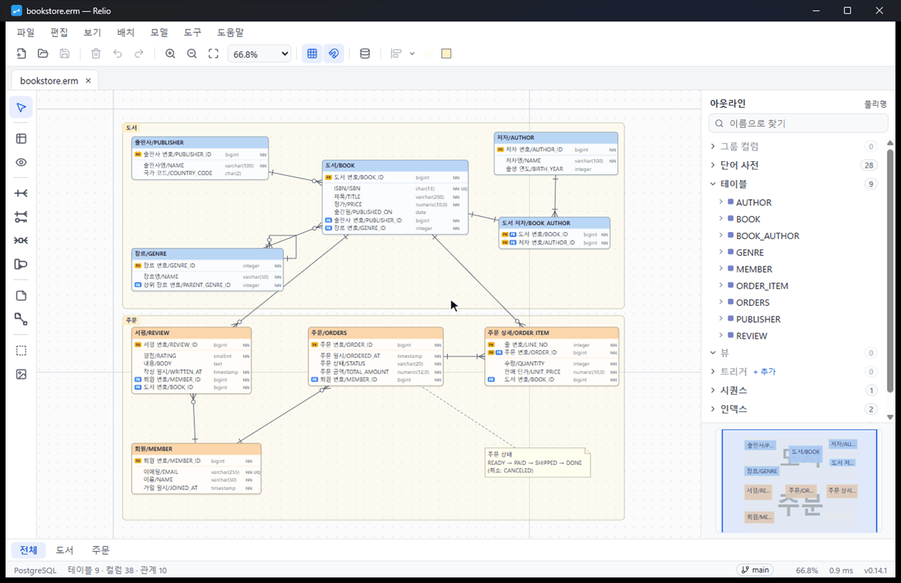
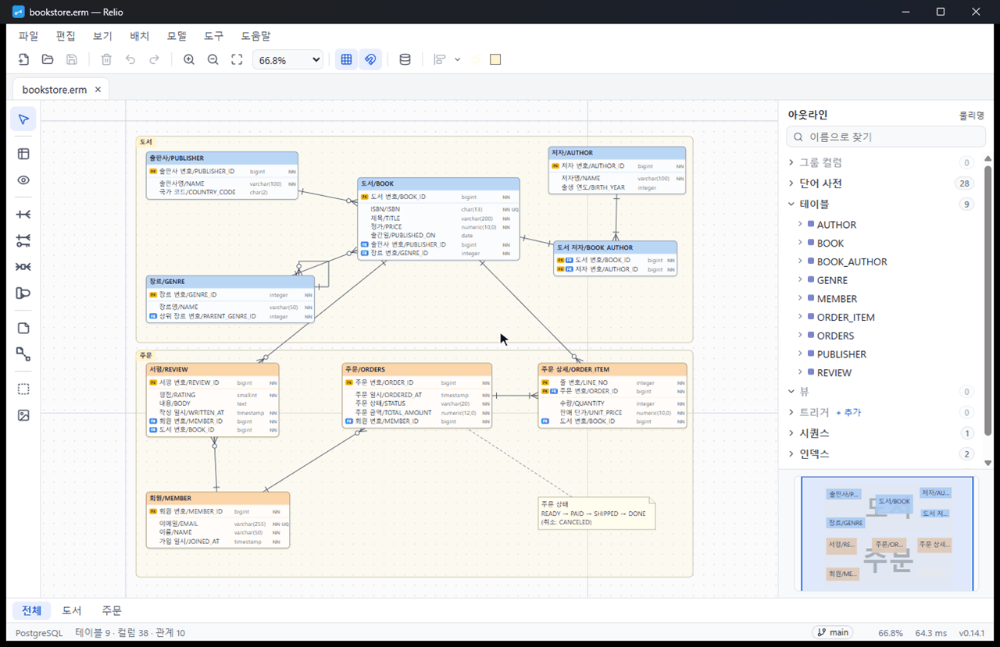
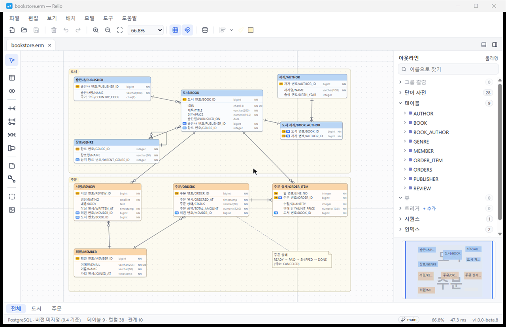
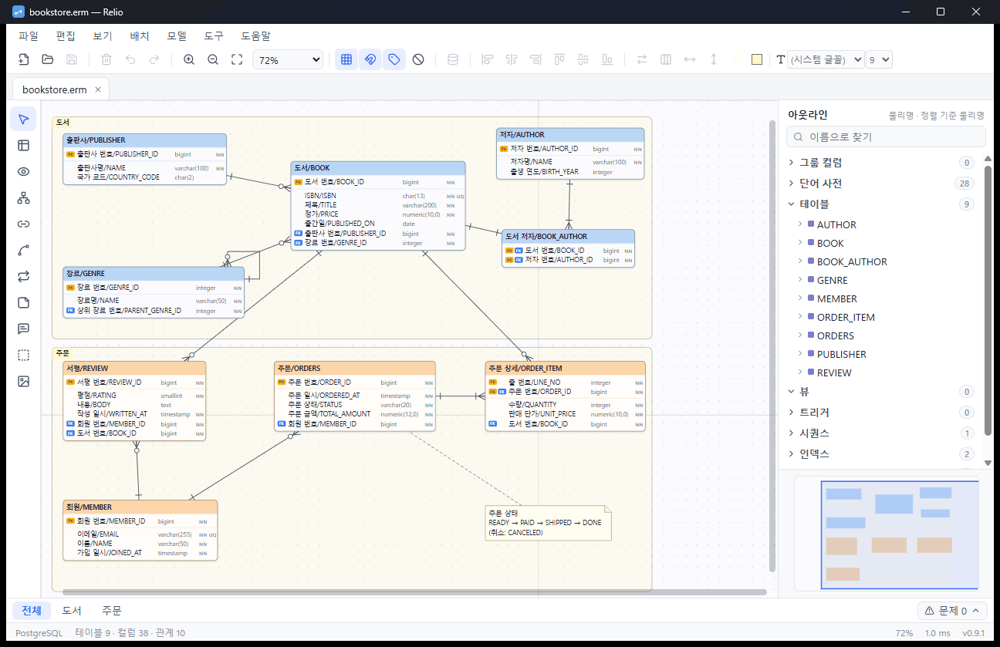

# Relio

> Modern ERD & database modeling tool — opens and saves ERMaster `.erm` files, no Eclipse required

[한국어](README.md) · **English**

**A desktop tool to keep working on your ERMaster diagrams, without Eclipse.**

> Relio is in pre-1.0 development. See [CHANGELOG.md](CHANGELOG.md) for changes in each version (Korean).

---

## What makes Relio different

The animations show the Korean interface in the light theme; every feature is also available in English. The "online bookstore" model is a made-up example.

### 1. Two people edit the same file — Relio merges by model object

Git merge conflicts and files changed outside Relio are merged by table, column and field, not by line. Tables added on both sides come in without conflicts, and you only choose where the same field was changed differently. The result is always a valid `.erm`, and a single undo reverts it. Register `relio merge` as a Git merge driver and `git merge` merges models the same way. Even in a model with 1,000 tables, the result is rebuilt within 0.05 seconds after each choice.

### 2. Design checks point out problems while you draw

14 rules — no primary key, foreign key without an index, reserved words, empty physical names or types, duplicate table names and more — run after every edit. Errors and warnings get a mark on the canvas and a count in the status bar. Info findings such as a foreign key without an index stay out of the way, collapsed to one line per rule in the problem list. Fix any finding there with one button, or ignore it. Nothing is blocked, and ignores are recorded on this PC, not in the `.erm`. Run the same checks in CI with `relio lint`.

### 3. Type a column name and get the columns you already use

Up to 8 suggestions come from the word dictionary and the columns of other tables, shown above the field so they never cover what you type. Pick one with the Down arrow and press Enter to fill the physical name, logical name, type and length at once, so the same column keeps the same type across tables.

### 4. Find by Korean initial consonants and highlight every result

The Ctrl+F find bar matches Korean names by their initial consonants as well as by full names. Every matching table, column, relationship and note is highlighted and the rest is dimmed, so you can see where things are even in a large model. Enter and F3 move between results.

### 5. Hover to highlight what is connected

Hover over a table, relationship line or column, and the connected lines and tables and the matching primary and foreign key columns are highlighted. Nothing else changes, so the screen doesn't dim as you move the mouse. Pause for a moment to see the type, NOT NULL and the referenced column in a tooltip. Click to select and everything outside the connection is dimmed for a closer look; the dim level and reduce motion can be changed in Settings.

## Everything you expect, built in

| | Feature |
|---|---|
| ✅ | **ERMaster `.erm` as is** — files saved by Relio open in ERMaster too, so mixed teams keep working together |
| ✅ | **ER diagrams** — tables, views, relationships (1:N, N:M, self-referencing), notes, categories, word dictionary, column groups |
| ✅ | **DDL for 12 databases** — PostgreSQL, MySQL, MariaDB, Oracle, SQL Server, Db2, H2, HSQLDB, SQLite, Informix, MS Access, standard SQL, with version-specific syntax |
| ✅ | **Live databases** — import from and export to a database (drivers built in for PostgreSQL, MySQL, MariaDB, SQL Server and SQLite) |
| ✅ | **Documents** — Excel table definitions (ERMaster templates work too), HTML, images, Markdown, Java, test data |
| ✅ | **Other formats** — import SQL (`pg_dump`, `mysqldump`), DBML, Mermaid and Markdown; export DBML, Mermaid and JSON |
| ✅ | **Git friendly** — sorted saving for small diffs, model comparison, commit history, merging by model object |
| ✅ | **Command line** — `relio export`, `import`, `diff`, `merge`, `lint` and `db`, with exit codes for builds and CI |
| ✅ | **Safe** — undo for every edit, automatic backup and recovery, damaged files repaired as far as possible |
| ✅ | **Comfortable** — light and dark themes, Korean and English interface, custom shortcuts, built-in user guide |
| ✅ | **Offline and free** — every feature works without the internet, and no usage data or file contents are sent anywhere |

## Install

Install with a single Windows installer, **`Relio_<version>_x64-setup.exe`**. Relio is free.

1. Download the latest installer from **[Releases](../../releases/latest)** and run it. To use Relio without installing, download `Relio_<version>_x64_portable.zip`, extract it and run `relio.exe`.
2. If Windows shows **"Windows protected your PC"** on first run, click **More info → Run anyway**. The installer is not code-signed yet, which causes this warning. Make sure you downloaded it from this repository.
3. Choose the installer language and whether to open `.erm` files with Relio.

- Supported: Windows 10 and 11 (64-bit). macOS support is planned once the feature set is stable.
- **No administrator rights needed.** Relio installs for the current user only.
- Microsoft Edge WebView2 is built into Windows 10 and 11. If it is missing, the installer downloads it — the only time an internet connection is needed.
- To uninstall, remove Relio in Windows Settings › Apps. Settings, connections and backups (`%APPDATA%\Relio`) are kept for a reinstall.

## Getting started

1. **Try a sample** — Choose "Open sample" on the start screen: a PostgreSQL sample (online bookstore) or a MySQL sample (membership and permissions). They cover relationships, indexes, views and test data, so they are good for exploring. Download: [PostgreSQL](assets/samples/bookstore-postgresql.erm) · [MySQL](assets/samples/membership-mysql.erm)
2. **Open a file** — "Open file" on the start screen (Ctrl+O), or drag an `.erm` file onto the window. Multiple files open in tabs.
3. **Create a model** — "New diagram" (Ctrl+N), then choose a database. You pick the location the first time you save.
4. **Draw a table** — Pick the table tool on the left and click the canvas. Double-click a table (or press Enter) to add columns.
5. **Connect a relationship** — Drag from the parent table to the child table with the relationship tool. The foreign key column is added automatically.
6. **Generate SQL** — File › Export › DDL. The preview updates as you choose the target database version.

For shortcuts and everything else (including merging, design checks and the command line), see the user guide below.

## More screenshots

Draw a table → rename in place → connect a relationship (foreign key added) → DDL preview

Screenshots show the Korean UI.

## Differences from ERMaster

Relio does everything ERMaster does, with known problems fixed. For example:

- DDL that used to fail on some databases is fixed and tested against old and current versions of 9 databases.
- Test data SQL no longer breaks on single quotes or empty values.
- Excel export uses `.xlsx` (ERMaster `.xls` templates still work).

## User guide

Shortcuts, database connections, merging and design checks, the command line (export, import, compare, merge, check), where settings and backups are stored, and troubleshooting are in the **user guide**.
- In the app: Help › User guide
- Online: [User guide](manual/en.md) · [사용 설명서 (Korean)](manual/ko.md)

## Report a problem · Suggest an idea

- Open an **[issue](../../issues/new/choose)** with the "Bug" or "Idea" form. In the app, **Help › Report a problem** opens the bug form with your Relio version and Windows version filled in (or use "Copy report details" if you can't use GitHub).
- First check whether **the same problem happens with a sample file**. If it does, we can fix it much faster.
- **Don't attach company `.erm` files or screenshots.** The table structure itself is company information. If a file causes the problem, try to reproduce it with a sample file, or use **"Save anonymized copy…"** in the Report a problem window to make a copy without names and descriptions (only the structure stays) and attach it as a zip file.
- Report security problems privately via **Security › Report a vulnerability** in this repository, not in a public issue.
- Code contributions (pull requests) are not accepted yet — open an issue instead.

## Terms of use

Relio is free for individuals and companies. You may share the unmodified installer; modifying or selling it is not allowed. Relio is provided as is. See [TERMS.md](TERMS.md) for the full terms.

---

ERMaster is a project of its original authors. Relio is a separate tool built independently to be compatible with its file format.
