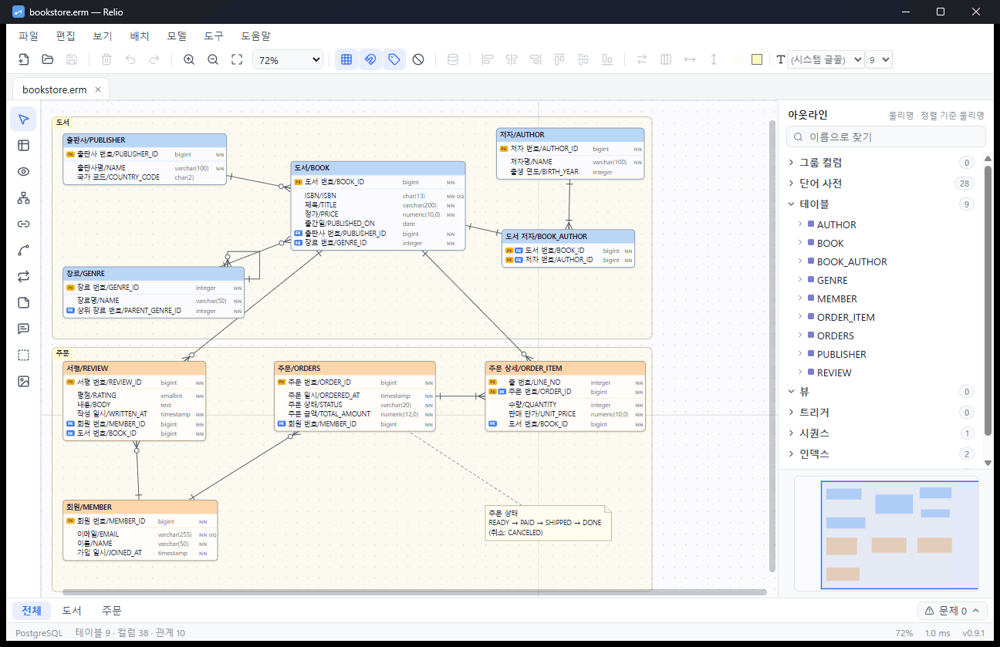
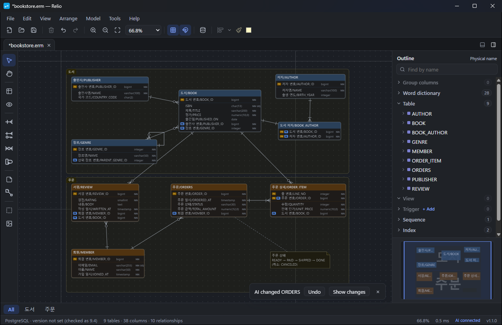
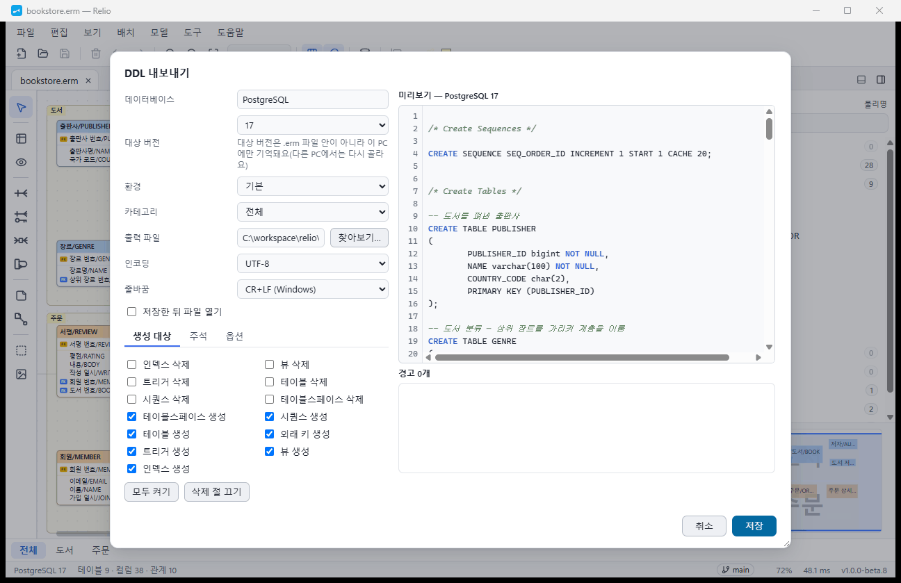
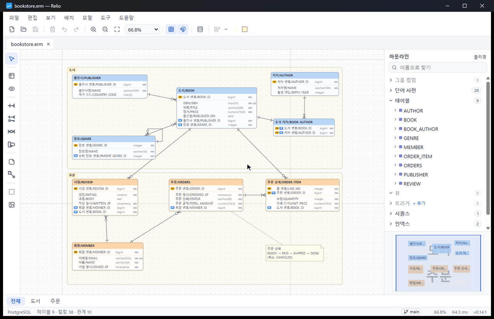
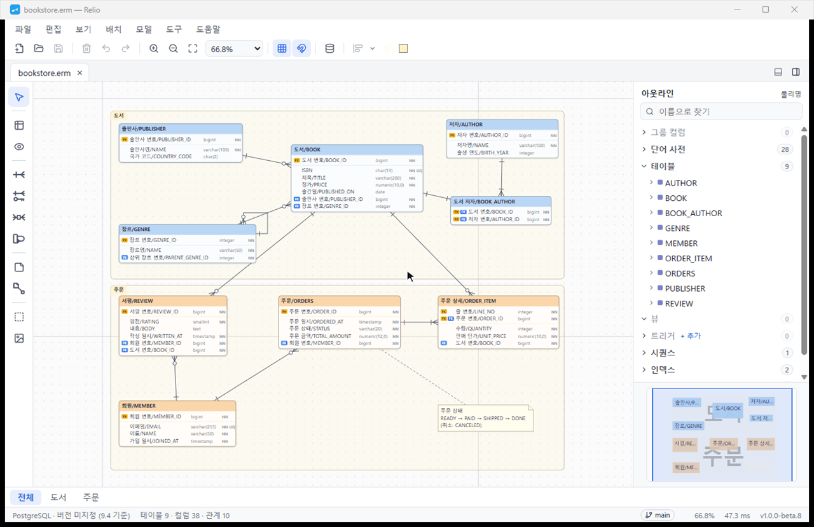

<p align="center"></p>

# Relio

[한국어](README.md) · **English**

**A modern, lightweight ERD modeling tool.**
Open ERMaster `.erm` files as they are, catch design problems as you draw, and generate DDL for 12 databases — no Eclipse needed. Ask your own AI tool for a change and see it right in the window.

**[Download](../../releases/latest)** · **[Relio website ↗](https://relio-hq.github.io/relio/en/)** · [Quick start ↗](https://relio-hq.github.io/relio/en/quick/start) · [User guide](manual/en.md)

<p align="center"></p>

<p align="center"><sub>Draw a table → rename in place → connect a relationship (foreign key added) → DDL preview (the animations show the Korean interface)</sub></p>

> Please try it and [tell us what you find](#report-a-problem--suggest-an-idea). See [CHANGELOG.md](CHANGELOG.md) for changes in each version (Korean). The installed version gets newer versions from inside Relio.

## Work with your AI tool

Ask your own AI tool (Claude Code, for example) in plain words, and it reads and changes your Relio model. The changes show up right away in the Relio window, with the changed tables highlighted. One Ctrl+Z takes them back, and the file changes only when you save.

<p align="center"></p>

- "Find where the order tables need an index"
- "Find columns that have no comment"
- "Add a payment table"

You usually don't have to say "Relio". Hand it a requirements document and it drafts an ERD and opens it in Relio.

Register once to connect. Paste the line below in a terminal, or copy it from **Tools › Command line & AI connection** in Relio.

```
claude mcp add --scope user relio -- relio mcp
```

- To look before anything is applied, choose "Review first" in **Settings › General › AI tools**. You also pick what goes in when a change overlaps your unsaved edits.
- The connection to Relio stays on your PC, and Relio uses no network and no sign-in for it. However, **what the AI reads (table and column names and descriptions) is sent to your AI service.** For company models, add `--anonymize` to hide names and descriptions (the AI then cannot change the model).
- Your AI tool can also edit files directly with its own editing features, so keep a backup of important models.

For other AI tools and all options, see the [user guide](manual/en.md#ai-tool-connection-mcp).

## Your ERMaster files, as they are

Open `.erm` files without Eclipse and save them in the same format. Teammates still on ERMaster can keep working on the same files, and opening and saving alone causes no diffs.

## Catches problems while you draw

<p align="center"></p>

No primary key, a foreign key without an index, reserved words and more are checked after every edit. Fix a finding with one button in the problem list, or ignore it. Nothing is blocked, and ignores are recorded on this PC, not in the `.erm`.

## 12 databases, version-aware

<p align="center"></p>

Pick the target database and version and the DDL preview updates right away. Import a model from a database, export to it, and generate change SQL (ALTER) from the difference between two models.

<details>
<summary><b>More that makes drawing easier</b> — column suggestions, find, connection highlighting</summary>

**Type a column name and get the columns you already use.** Accepting one fills the name, type and length at once.

<p align="center"></p>

**Ctrl+F highlights every match, and finds Korean names by their initial consonants.**

<p align="center"></p>

**Hover to highlight only the connected lines, tables and columns.**

<p align="center"></p>

</details>

<sub>The "online bookstore" model is a made-up example.</sub>

## Everything you expect, built in

| | Feature |
|---|---|
| ✅ | **ER diagrams** — tables, views, relationships (1:N, N:M, self-referencing), notes, categories (view several together), word dictionary, column groups |
| ✅ | **DDL for 12 databases** — PostgreSQL, MySQL, MariaDB, Oracle, SQL Server, Db2, H2, HSQLDB, SQLite, Informix, MS Access, standard SQL, with version-specific syntax |
| ✅ | **Live databases** — import from and export to a database (drivers built in for PostgreSQL, MySQL, MariaDB, SQL Server and SQLite) |
| ✅ | **Documents** — Excel table definitions (ERMaster templates work too), HTML, images, Markdown, Java, test data |
| ✅ | **Other formats** — import SQL (`pg_dump`, `mysqldump`), DBML, Mermaid and Markdown; export DBML, Mermaid and JSON |
| ✅ | **Compare and merge** — compare two models, change SQL (ALTER; PostgreSQL, MySQL, MariaDB, SQL Server, Oracle), merge by table and column, view Git history |
| ✅ | **Command line** — `relio export`, `import`, `diff`, `merge`, `lint`, `db` and `mcp`, with exit codes for builds and CI |
| ✅ | **Workflow** — reopen the tabs you had open, move around with the hand tool, open the folder of an exported file, a target database version per file |
| ✅ | **Safe** — undo for every edit, automatic backup and recovery, damaged files repaired as far as possible |
| ✅ | **Comfortable** — 6 themes (light, dark, Cherry blossom, Lavender, Catppuccin Mocha, Frost), Korean and English interface, custom shortcuts, built-in user guide |
| ✅ | **Offline and free** — drawing, checking and exporting work without the internet, and Relio sends no usage data or file contents anywhere |

## Install

Install with a single Windows installer, **`Relio_<version>_x64-setup.exe`**. Relio is free.

1. Download the latest installer from **[Releases](../../releases/latest)** and run it. To use Relio without installing, download `Relio_<version>_x64_portable.zip`, extract it and run `relio.exe`.
2. If Windows shows **"Windows protected your PC"** on first run, click **More info → Run anyway**. The installer is not code-signed yet, which causes this warning. Make sure you downloaded it from this repository.
3. Choose the installer language and whether to open `.erm` files with Relio.

- Supported: Windows 10 and 11 (64-bit).
- **No administrator rights needed.** Relio installs for the current user only.
- To run `relio` from a terminal or an AI tool, turn on **"Use relio from the command line"** on the last page of the installer (off by default). If you leave it off, or use the portable version, copy the full path from **Tools › Command line & AI connection** or Help › About Relio.
- Microsoft Edge WebView2 is built into Windows 10 and 11. If it is missing, the installer downloads it — the only time an internet connection is needed.
- To uninstall, remove Relio in Windows Settings › Apps. Settings, connections and backups (`%APPDATA%\Relio`) are kept for a reinstall.

## Getting started

New to Relio? Follow the **[quick start ↗](https://relio-hq.github.io/relio/en/quick/start)** on the website.

- **Try a sample** — "Open sample" on the start screen. Download: [PostgreSQL](assets/samples/bookstore-postgresql.erm) · [MySQL](assets/samples/membership-mysql.erm)
- **Open a file** — Ctrl+O, or drag an `.erm` file onto the window
- **Generate SQL** — File › Export › DDL

## Differences from ERMaster

Relio does everything ERMaster does, with known problems fixed. For example:

- DDL that used to fail on some databases is fixed and tested against old and current versions of 9 databases.
- Test data SQL no longer breaks on single quotes or empty values.
- Excel export uses `.xlsx` (ERMaster `.xls` templates still work).
- Table boxes always fit their content. Only the drawing changes; sizes and positions stored in the file stay as they are.

## User guide

Shortcuts, database connections, merging and design checks, the command line, AI tool connection, where settings and backups are stored, and troubleshooting are in the **user guide**.
- In the app: Help › User guide
- On the web: [Relio website ↗](https://relio-hq.github.io/relio/en/) · [User guide](manual/en.md) · [사용 설명서 (Korean)](manual/ko.md)

## Report a problem · Suggest an idea

- Open an **[issue](../../issues/new/choose)** with the "Bug" or "Idea" form. In the app, **Help › Report a problem** opens the bug form with your Relio version and Windows version filled in (or use "Copy report details" if you can't use GitHub).
- If the app froze or closed unexpectedly, use **"Copy recent log"** in the Report a problem window to copy the diagnostic log (it contains no file contents, names or paths) and paste it into the issue. It helps us find the cause much faster.
- First check whether **the same problem happens with a sample file**. If it does, we can fix it much faster.
- **Don't attach company `.erm` files or screenshots.** The table structure itself is company information. If a file causes the problem, try to reproduce it with a sample file, or use **"Save anonymized copy…"** in the Report a problem window to make a copy without names and descriptions (only the structure stays) and attach it as a zip file.
- Report security problems privately via **Security › Report a vulnerability** in this repository, not in a public issue.
- Code contributions (pull requests) are not accepted yet — open an issue instead.

## Terms of use

Relio is free for individuals and companies. You may share the unmodified installer; modifying or selling it is not allowed. Relio is provided as is. See [TERMS.md](TERMS.md) for the full terms.

---

Relio is a separate tool, not affiliated with ERMaster. It was written from scratch without using ERMaster source code and is only compatible with the ERMaster file format (.erm). ERMaster is a project of its developers.
Windows, PostgreSQL, MySQL, Oracle and other product names are trademarks of their respective owners.
