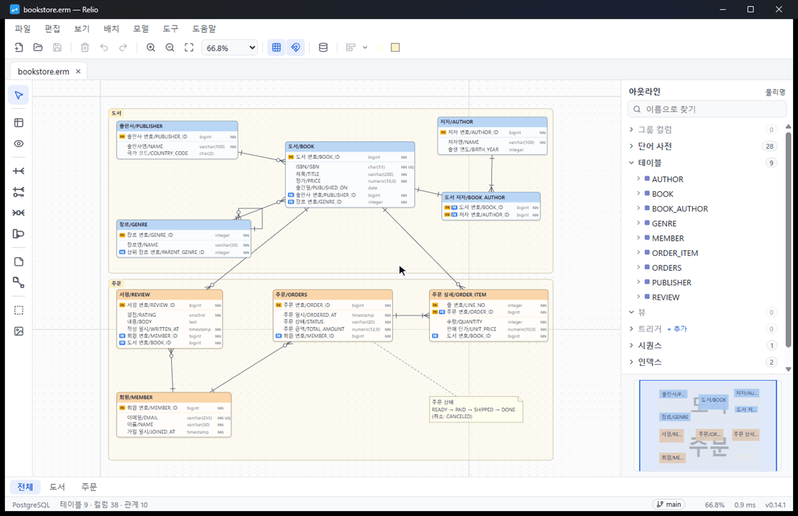
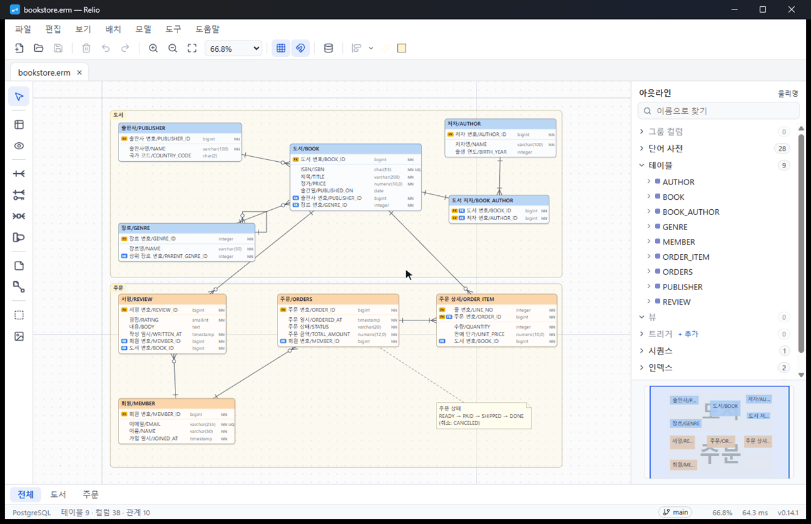
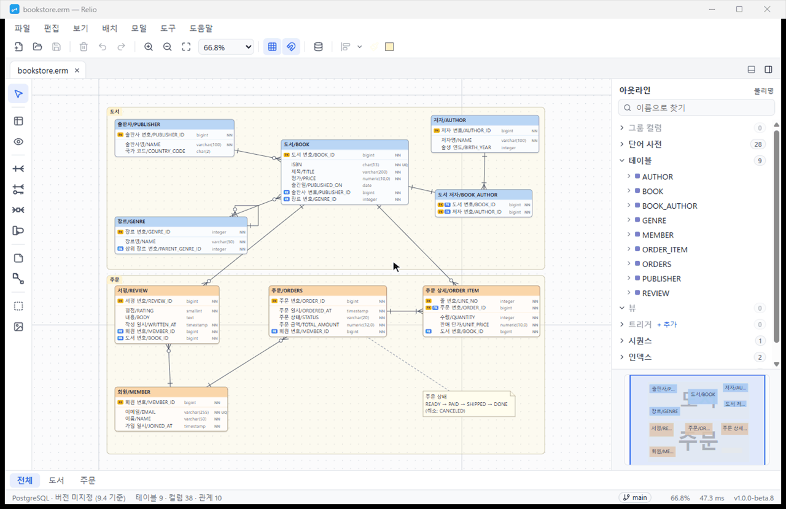
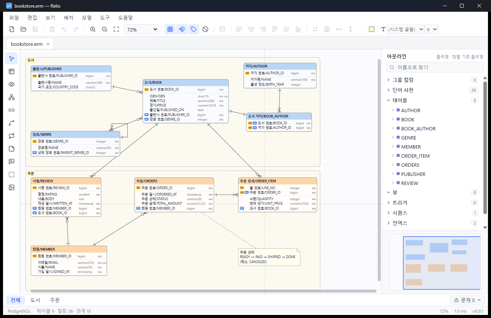
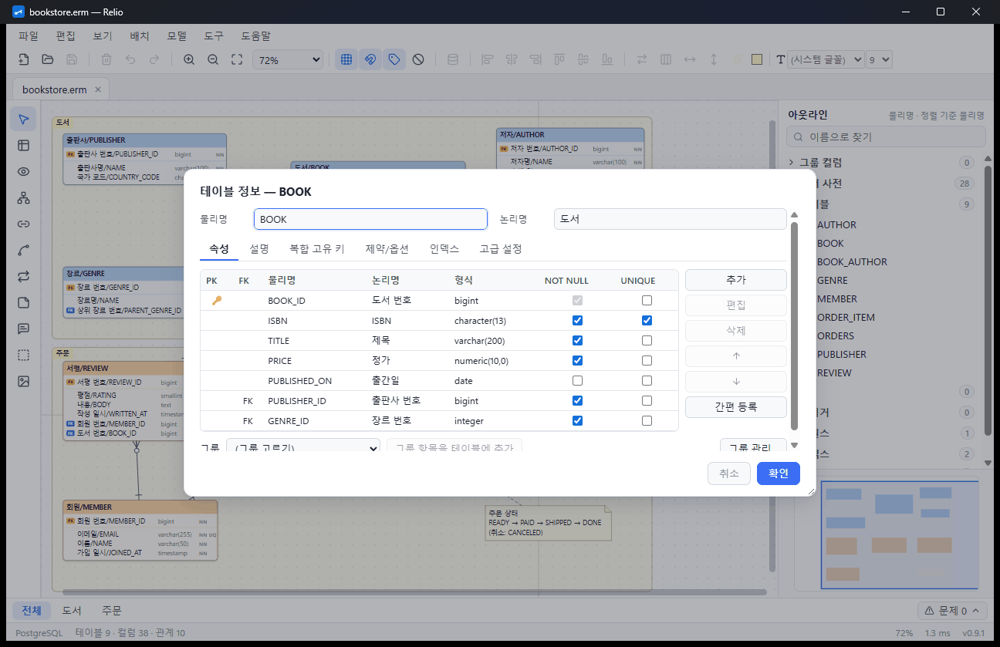
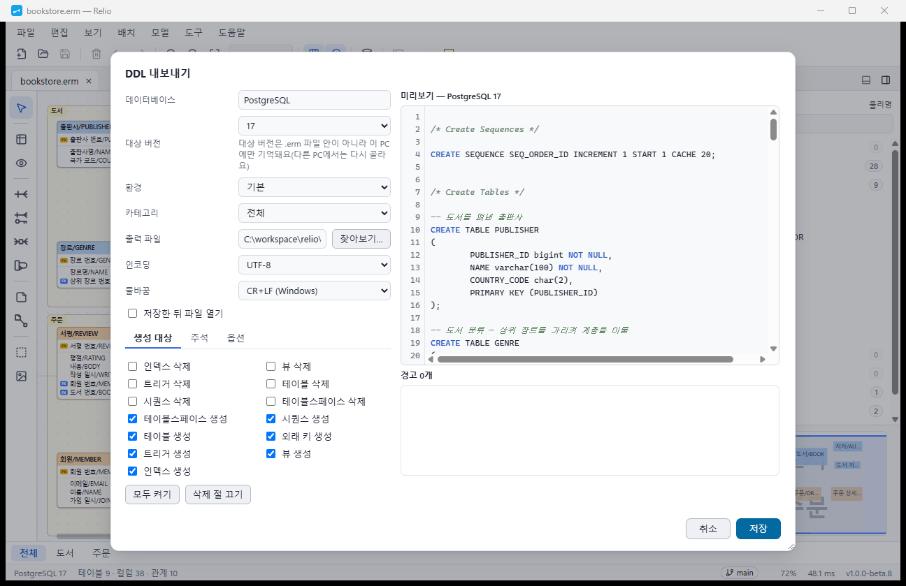
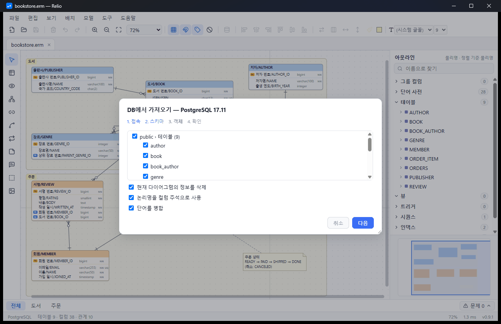
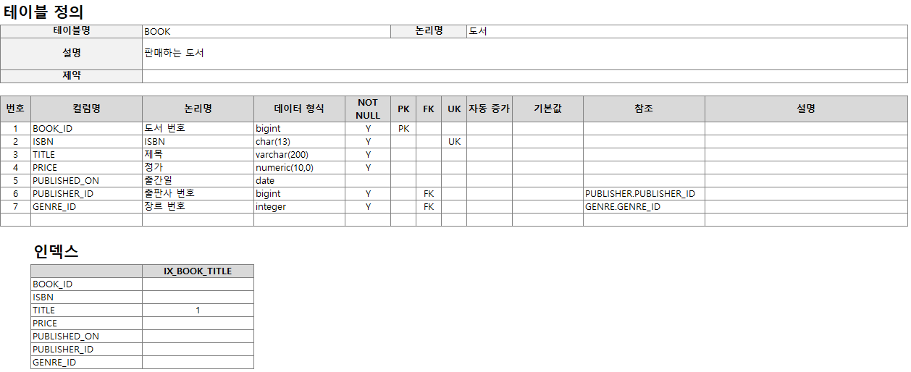
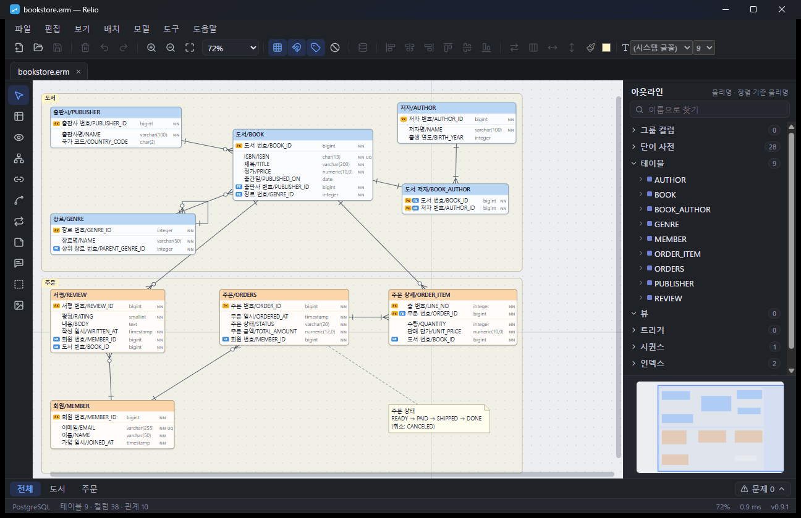

# Relio

> Modern ERD & database modeling tool — opens and saves ERMaster `.erm` files, no Eclipse required

**한국어** · [English](README.en.md)

**ERMaster로 그리던 ERD를 Eclipse 없이, 그대로 이어서 그리는 데스크톱 도구.**

> 지금은 **1.0.0 베타**입니다. 써 보시고 [문제 보고](#문제-알리기--아이디어)로 알려 주세요. 버전별 변경은 [CHANGELOG.md](CHANGELOG.md)에 있습니다.

---

## Relio가 특별한 점

### 1. 같은 파일을 둘이 고쳐도 모델 단위로 합쳐요

Git 병합 충돌이나 바깥에서 바뀐 파일을 줄이 아니라 테이블·컬럼·필드 단위로 합쳐요. 양쪽이 각자 더한 테이블은 충돌 없이 들어오고, 같은 칸을 다르게 고친 것만 골라요. 결과는 늘 올바른 `.erm`이고 되돌리기 한 번으로 돌아가요. 명령줄 `relio merge`를 Git merge driver로 등록하면 `git merge`도 모델 단위로 합쳐요. 테이블 1,000개 모델에서도 하나를 고르면 0.05초 안에 결과를 다시 맞춰요.

### 2. 설계 검사가 그리는 동안 문제를 알려 줘요

기본 키 없음, 외래 키에 인덱스 없음, 예약어 이름, 비어 있는 물리명·형식, 같은 이름 테이블 등 14가지 규칙으로 편집할 때마다 검사해요. 오류·경고는 캔버스에 표시가 붙고 상태 표시줄에 개수가 나와요. 외래 키 인덱스 없음 같은 참고는 화면을 어지럽히지 않게 문제 목록에 규칙마다 한 줄로 접혀 있어요. 문제 목록에서 단추 하나로 고치거나 예외로 둬요. 무엇도 막지 않고, 예외는 `.erm`이 아니라 이 PC에 기록해요. `relio lint`로 CI에서도 같은 검사를 돌려요.

### 3. 컬럼 이름을 치면 이미 쓰던 컬럼을 추천해요

단어 사전과 다른 테이블의 컬럼에서 후보를 최대 8개 칸 위로 보여 줘서 치는 칸을 가리지 않아요. ↓로 고른 뒤 Enter로 받으면 물리명·논리명·형식·길이가 한 번에 채워져요. 같은 뜻의 컬럼이 테이블마다 다른 형식이 되는 일을 줄여요.

### 4. 한글 초성으로 찾고, 결과를 모두 강조해요

Ctrl+F 찾기 막대에 "ㅈㅁ"만 쳐도 "주문"을 찾아요. 테이블·컬럼·관계·노트 이름에서 찾은 결과를 모두 강조하고 나머지는 흐리게 해서, 큰 모델에서도 어디 있는지 한눈에 보여요. Enter·F3로 결과 사이를 옮겨 다녀요.

### 5. 마우스를 올리면 연결된 것만 진하게 보여요

테이블·관계선·컬럼에 마우스를 올리면 연결된 선과 테이블, 짝이 되는 기본 키·외래 키 컬럼이 진하게 강조돼요. 나머지는 그대로라 움직일 때마다 화면이 흐려지지 않아요. 잠시 머물면 형식·NOT NULL·참조 대상이 도구 설명으로 나와요. 클릭해 고르면 연결 밖을 흐리게 해서 더 또렷하게 볼 수 있고, 흐림 정도와 움직임 줄이기는 환경 설정에서 바꿔요.

그림은 한국어 화면·밝은 테마이고, "온라인 서점" 모델은 소개용으로 꾸며낸 예제예요.

## 기본으로 다 됩니다

| | 기능 |
|---|---|
| ✅ | **ERMaster `.erm` 그대로** — 열고 저장한 파일을 ERMaster에서도 열어요. 팀에 ERMaster 사용자가 있어도 함께 써요 |
| ✅ | **ERD 그리기** — 테이블·뷰·관계(1:N·N:M·재귀)·노트·카테고리, 단어 사전, 그룹 컬럼 |
| ✅ | **DDL 12가지 DB** — PostgreSQL·MySQL·MariaDB·Oracle·SQL Server·DB2·H2·HSQLDB·SQLite·Informix·MS Access·표준 SQL, 버전별 문법 |
| ✅ | **DB 연동** — DB에서 가져오기·DB로 내보내기(PostgreSQL·MySQL·MariaDB·SQL Server·SQLite는 드라이버 내장) |
| ✅ | **문서 내보내기** — Excel 테이블 정의서(ERMaster 템플릿도 그대로)·HTML·이미지·Markdown·Java·테스트 데이터 |
| ✅ | **다른 형식 주고받기** — SQL(`pg_dump`·`mysqldump`)·DBML·Mermaid·Markdown 가져오기, DBML·Mermaid·JSON 내보내기 |
| ✅ | **Git과 함께** — 정렬 저장으로 작은 차이, 두 모델 비교, 커밋 이력, 모델 단위 합치기 |
| ✅ | **명령줄** — `relio export`·`import`·`diff`·`merge`·`lint`·`db`, 빌드·CI용 종료 코드 |
| ✅ | **안전하게** — 모든 편집 되돌리기, 자동 백업과 복구, 망가진 파일도 고칠 수 있는 데까지 고쳐서 열기 |
| ✅ | **편하게** — 밝은·어두운 테마, 한국어·영어 화면, 단축키 바꾸기, 앱 안 사용 설명서 |
| ✅ | **인터넷 없이·무료** — 모든 기능이 오프라인으로 동작하고, 사용 기록이나 파일 내용을 밖으로 보내지 않아요 |

## 설치

Windows 설치 파일 **`Relio_<버전>_x64-setup.exe`** 하나로 설치해요(예: `Relio_1.0.0-beta.3_x64-setup.exe`). 무료예요. 지금 있는 기능은 앞으로도 계속 무료예요.

1. 이 저장소의 **[Releases](../../releases/latest)**에서 최신 설치 파일을 받아 실행해요. 설치 없이 쓰려면 `Relio_<버전>_x64_portable.zip`을 받아 압축을 풀고 `relio.exe`를 실행하세요.
2. 처음 실행할 때 Windows가 **"Windows의 PC 보호"** 창을 띄우면 **추가 정보 → 실행**을 누르세요. Relio 설치 파일은 아직 코드 서명을 하지 않아서 나오는 경고예요. 받은 곳이 맞는지 먼저 확인하세요.
3. 설치 언어를 고르고, `.erm` 파일을 Relio로 열지 고르면 끝이에요.

- 지원: Windows 10·11 (64비트). macOS는 기능이 안정된 뒤에 지원할 예정이에요.
- **관리자 권한이 필요 없어요.** 지금 사용자 계정에만 설치돼요.
- 화면 표시에 쓰는 Microsoft Edge WebView2는 Windows 10·11에 기본으로 들어 있어요. 빠진 PC라면 설치할 때 받아 오므로 그때만 인터넷이 필요해요.
- 회사 PC가 서명 없는 프로그램 실행을 막고 있으면 사내 관리자에게 문의하세요.
- 지우기: Windows 설정 › 앱에서 Relio를 제거해요. 설정·연결 목록·백업(`%APPDATA%\Relio`)은 남아서 다시 설치하면 그대로 써요.

## 처음 시작하기

1. **샘플로 바로 써 보기** — 시작 화면의 "샘플 열기"에서 PostgreSQL 샘플(온라인 서점)이나 MySQL 샘플(회원·권한 관리)을 고르세요. 관계·인덱스·뷰·테스트 데이터까지 고루 들어 있어서 뜯어보기 좋아요. 파일로도 받을 수 있어요: [PostgreSQL](assets/samples/bookstore-postgresql.erm) · [MySQL](assets/samples/membership-mysql.erm)
2. **기존 파일 열기** — 시작 화면의 "파일 열기"(Ctrl+O), 또는 `.erm` 파일을 창에 끌어다 놓으세요. 여러 파일은 탭으로 열려요.
3. **새로 만들기** — "새 다이어그램"(Ctrl+N)에서 DB 종류를 고르면 빈 문서가 열려요. 처음 저장할 때 위치와 이름을 정해요.
4. **테이블 그리기** — 왼쪽 도구 모음에서 테이블을 고르고 캔버스를 클릭하세요. 테이블을 더블클릭(또는 Enter)하면 정보 창이 열려 컬럼을 넣을 수 있어요.
5. **관계 잇기** — 관계 도구로 부모 테이블에서 자식 테이블로 끌면 외래 키 컬럼이 자동으로 생겨요.
6. **SQL 만들기** — 파일 › 내보내기 › DDL. 대상 DB 버전을 고르면 미리보기가 바로 바뀌어요.

단축키와 더 자세한 사용법(합치기·설계 검사·명령줄 포함)은 아래 "자세한 사용법"의 사용 설명서를 보세요.

## 더 둘러보기

테이블 그리기 → 이름 바로 고치기 → 관계 잇기(외래 키 자동) → DDL 미리보기

| | |
|---|---|
|  |  |
| **캔버스** — 테이블·관계·노트·카테고리, 오른쪽 아웃라인과 미니맵 | **테이블 정보** — 컬럼·키·인덱스·제약을 한 창에서 |
|  |  |
| **DDL 미리보기** — DB와 버전을 고르면 바로 바뀌어요 | **DB에서 가져오기** — 접속해서 테이블을 골라 모델로 |
|  |  |
| **Excel 테이블 정의서** — 한국어 기본 양식 | **어두운 테마** — 환경 설정에서 고르거나 Windows 설정을 따라요(다이어그램은 밝은 바탕) |

## ERMaster와 다른 점

Relio는 ERMaster의 기능을 모두 하되, 알려진 문제는 고쳐서 동작해요. 예를 들면:

- DB에 따라 실행 중 오류가 나던 DDL을 9가지 DB의 옛 버전과 최신 버전에서 실제로 실행해 확인했어요.
- 테스트 데이터 SQL에서 작은따옴표·빈 값 때문에 SQL이 깨지던 문제를 고쳤어요.
- Excel 출력은 `.xlsx`예요(ERMaster `.xls` 템플릿은 그대로 쓸 수 있어요).

## 자세한 사용법

단축키, DB 연결, 합치기·설계 검사, 명령줄(내보내기·가져오기·비교·합치기·검사), 설정·백업이 저장되는 곳, 문제 해결은 **사용 설명서**에 있어요.
- 앱 안: 도움말 › 사용 설명서
- 온라인: [사용 설명서](manual/ko.md) · [User guide (English)](manual/en.md)

## 문제 알리기 · 아이디어

- **[Issues](../../issues/new/choose)**에서 "버그" 또는 "아이디어" 양식으로 남겨 주세요. 앱의 **도움말 › 문제 보고**를 누르면 Relio 버전·Windows 버전을 채운 버그 양식이 열려요(GitHub를 쓸 수 없으면 "보고 내용 복사").
- 먼저 **샘플 파일로도 같은 문제가 생기는지** 확인해 주세요. 샘플로 재현되면 고치기가 훨씬 빨라요.
- **회사 `.erm` 파일이나 화면 캡처를 올리지 마세요.** 테이블 구조 자체가 회사 정보예요. 파일 때문에 생긴 문제라면 샘플 파일로 재현해 보거나, 문제 보고 창의 **"익명화 사본 저장…"**으로 이름·설명을 지운 사본(구조만 남음)을 만들어 zip으로 묶어 붙여 주세요.
- 보안 문제는 공개 이슈 대신 이 저장소의 **Security › Report a vulnerability**(비공개 제보)로 알려 주세요.
- 코드 기여(Pull Request)는 아직 받지 않아요. 이슈로 남겨 주시면 반영할게요.

## 사용 조건

- Relio는 개인·회사 모두 **무료**로 쓸 수 있어요. 지금 있는 기능은 앞으로도 계속 무료예요.
- 받은 설치 파일·실행판을 고치지 않은 그대로 다른 사람에게 전해도 돼요. 고치거나, 팔거나, 다른 이름으로 내놓는 것은 안 돼요.
- Relio는 있는 그대로 제공돼요. 중요한 모델은 따로 백업해 두세요.

전체 조건은 [TERMS.md](TERMS.md)에 있어요.

---

ERMaster는 원 저작자의 프로젝트이며, Relio는 그 파일 형식과 호환되도록 독립적으로 만든 별개의 도구입니다.
