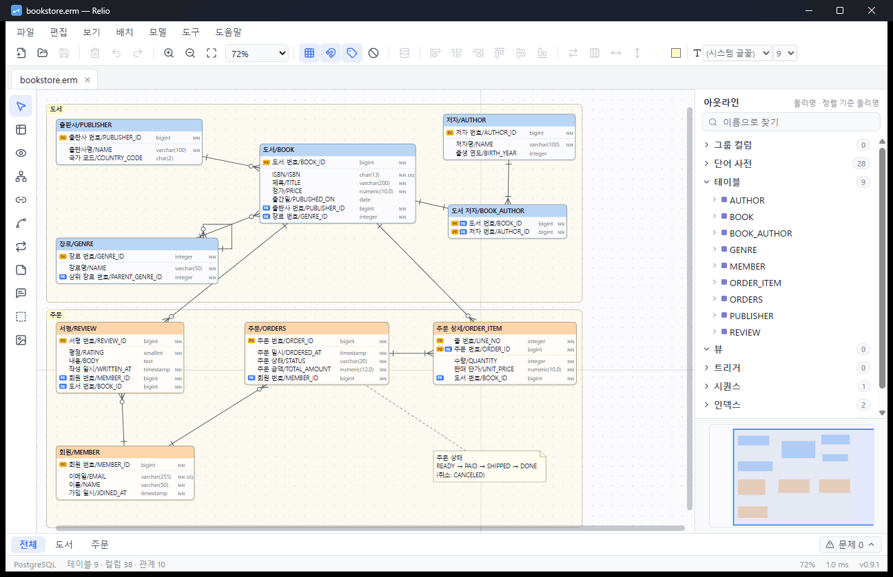
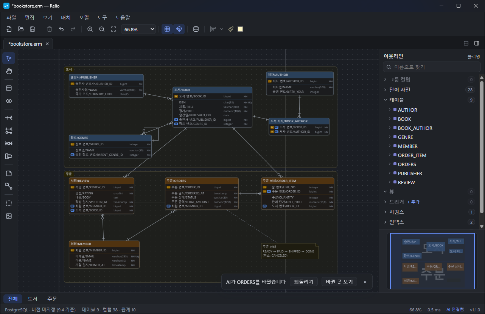
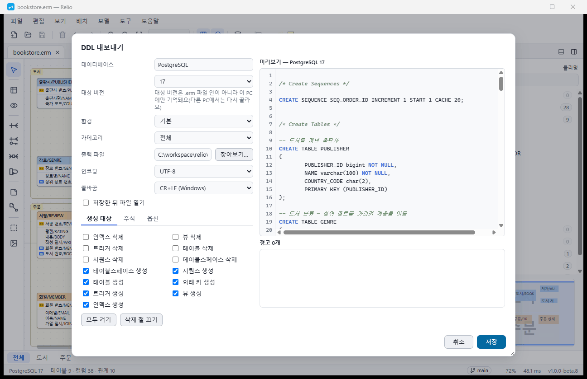
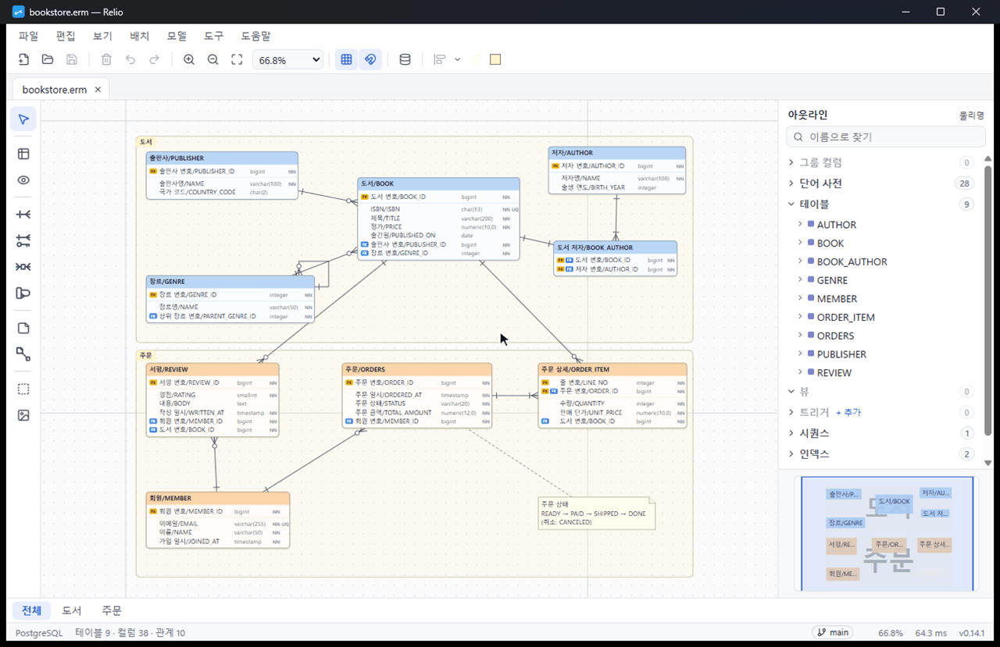
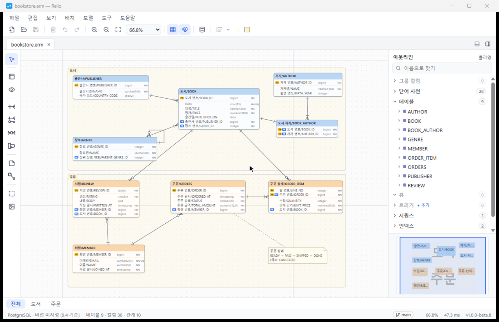

<p align="center"></p>

# Relio

**한국어** · [English](README.en.md)

**가볍고 현대적인 ERD 모델링 도구.**
ERMaster `.erm` 파일을 그대로 열고, 그리는 동안 설계를 검사하고, 12가지 DB의 DDL까지 — Eclipse 없이. 내 AI 도구에 말로 요청해 고치면 창에 바로 보여요.

**[내려받기](../../releases/latest)** · **[Relio 웹사이트 ↗](https://relio-hq.github.io/relio/)** · [빠른 시작 ↗](https://relio-hq.github.io/relio/quick/start) · [사용 설명서](manual/ko.md)

<p align="center"></p>

<p align="center"><sub>테이블 그리기 → 이름 바로 고치기 → 관계 잇기(외래 키 자동) → DDL 미리보기</sub></p>

> 써 보시고 [문제 보고](#문제-알리기--아이디어)로 알려 주세요. 버전별 변경은 [CHANGELOG.md](CHANGELOG.md)에 있어요. 설치판은 새 버전을 Relio 안에서 받아요.

## 내 AI 도구와 함께

내 AI 도구(Claude Code 등)에 말로 요청하면 Relio 모델을 읽고 고쳐요. 고친 내용은 Relio 창에 바로 보이고 바뀐 테이블이 강조돼요. 마음에 안 들면 Ctrl+Z 한 번이면 되고, 파일은 내가 저장할 때만 바뀌어요.

<p align="center"></p>

- "주문 테이블에 인덱스가 필요한 곳 찾아 줘"
- "코멘트 빠진 컬럼 찾아 줘"
- "결제 테이블 추가해 줘"

"Relio"라고 말하지 않아도 대개 알아서 Relio를 써요. 요구사항 문서를 주면 ERD 초안을 만들어 Relio에 열어 줘요.

연결은 처음 한 번만 등록하면 돼요. 아래 줄을 터미널에 붙여 넣거나, Relio의 **도구 › 명령줄·AI 연결**에서 복사하세요.

```
claude mcp add --scope user relio -- relio mcp
```

- 바로 반영하기 전에 먼저 보고 싶으면 **환경 설정 › 일반 › AI 도구**에서 "먼저 검토"를 고르세요. 저장하지 않은 편집과 겹칠 때도 직접 골라 넣어요.
- Relio와의 연결은 내 PC 안에서만 동작하고, Relio는 이를 위해 네트워크에 접속하거나 로그인하지 않아요. 다만 **AI가 읽은 내용(테이블·컬럼 이름과 설명)은 내 AI 서비스로 전송돼요.** 회사 모델은 이름·설명을 가리는 `--anonymize`를 붙이세요(이때는 AI가 모델을 고치지 않아요).
- AI 도구는 자기 편집 기능으로 파일을 직접 고칠 수도 있으니, 중요한 모델은 백업해 두세요.

다른 AI 도구의 등록 방법과 옵션은 [사용 설명서](manual/ko.md#ai-도구-연결-mcp)에 있어요.

## 쓰던 ERMaster 파일 그대로

Eclipse 없이 `.erm`을 열고 같은 형식으로 저장해요. 팀에 ERMaster 사용자가 있어도 섞어 쓸 수 있고, 열고 저장한 것만으로는 파일에 차이가 생기지 않아요.

## 그리는 동안 먼저 알려 줘요

<p align="center"></p>

기본 키 없음, 인덱스 없는 외래 키, 예약어 이름 같은 문제를 편집할 때마다 검사해요. 문제 목록에서 단추 하나로 고치거나 예외로 둬요. 무엇도 막지 않고, 예외는 `.erm`이 아니라 이 PC에 기록해요.

## 12가지 DB, 버전별 문법까지

<p align="center"></p>

대상 DB와 버전을 고르면 DDL 미리보기가 바로 바뀌어요. DB에서 모델을 가져오고, DB로 내보내고, 두 모델의 차이로 변경 SQL(ALTER)도 만들어요.

<details>
<summary><b>그릴 때 편한 점 더 보기</b> — 컬럼 추천, 초성 찾기, 연결 강조</summary>

**컬럼 이름을 치면 이미 쓰던 컬럼을 추천해요.** 받으면 이름·형식·길이가 한 번에 채워져요.

<p align="center"></p>

**Ctrl+F에 "ㅈㅁ"만 쳐도 "주문"을 찾고, 결과를 모두 강조해요.**

<p align="center"></p>

**마우스를 올리면 연결된 선·테이블·컬럼만 진하게 보여요.**

<p align="center"></p>

</details>

<sub>그림의 "온라인 서점" 모델은 소개용으로 꾸며낸 예제예요.</sub>

## 기본으로 다 됩니다

| | 기능 |
|---|---|
| ✅ | **ERD 그리기** — 테이블·뷰·관계(1:N·N:M·재귀)·노트·카테고리(여러 개 함께 보기), 단어 사전, 그룹 컬럼 |
| ✅ | **DDL 12가지 DB** — PostgreSQL·MySQL·MariaDB·Oracle·SQL Server·DB2·H2·HSQLDB·SQLite·Informix·MS Access·표준 SQL, 버전별 문법 |
| ✅ | **DB 연동** — DB에서 가져오기·DB로 내보내기(PostgreSQL·MySQL·MariaDB·SQL Server·SQLite는 드라이버 내장) |
| ✅ | **문서 내보내기** — Excel 테이블 정의서(ERMaster 템플릿도 그대로)·HTML·이미지·Markdown·Java·테스트 데이터 |
| ✅ | **다른 형식 주고받기** — SQL(`pg_dump`·`mysqldump`)·DBML·Mermaid·Markdown 가져오기, DBML·Mermaid·JSON 내보내기 |
| ✅ | **비교·합치기** — 두 모델 비교, 변경 SQL(ALTER, PostgreSQL·MySQL·MariaDB·SQL Server·Oracle), 테이블·컬럼 단위 합치기, Git 이력 보기 |
| ✅ | **명령줄** — `relio export`·`import`·`diff`·`merge`·`lint`·`db`·`mcp`, 빌드·CI용 종료 코드 |
| ✅ | **작업 흐름** — 껐다 켜면 열던 탭 그대로, 손 도구로 화면 옮기기, 내보낸 파일의 폴더 바로 열기, 파일마다 대상 DB 버전 |
| ✅ | **안전하게** — 모든 편집 되돌리기, 자동 백업과 복구, 망가진 파일도 고칠 수 있는 데까지 고쳐서 열기 |
| ✅ | **편하게** — 테마 6가지(낮·밤과 벚꽃·라벤더·모카·서리), 한국어·영어 화면, 단축키 바꾸기, 앱 안 사용 설명서 |
| ✅ | **인터넷 없이·무료** — 그리기·검사·내보내기는 오프라인으로 동작하고, Relio는 사용 기록이나 파일 내용을 밖으로 보내지 않아요 |

## 설치

Windows 설치 파일 **`Relio_<버전>_x64-setup.exe`** 하나로 설치해요. 무료예요. 지금 있는 기능은 앞으로도 계속 무료예요.

1. 이 저장소의 **[Releases](../../releases/latest)**에서 최신 설치 파일을 받아 실행해요. 설치 없이 쓰려면 `Relio_<버전>_x64_portable.zip`을 받아 압축을 풀고 `relio.exe`를 실행하세요.
2. 처음 실행할 때 Windows가 **"Windows의 PC 보호"** 창을 띄우면 **추가 정보 → 실행**을 누르세요. Relio 설치 파일은 아직 코드 서명을 하지 않아서 나오는 경고예요. 받은 곳이 맞는지 먼저 확인하세요.
3. 설치 언어를 고르고, `.erm` 파일을 Relio로 열지 고르면 끝이에요.

- 지원: Windows 10·11 (64비트).
- **관리자 권한이 필요 없어요.** 지금 사용자 계정에만 설치돼요.
- 터미널이나 AI 도구에서 `relio`를 바로 부르려면 설치 마지막 화면의 **"명령줄에서 relio 쓰기"** 칸을 켜세요(기본은 꺼짐). 켜지 않았거나 실행판이면 **도구 › 명령줄·AI 연결**이나 도움말 › Relio 정보에서 전체 경로를 복사해 쓰면 돼요.
- 화면 표시에 쓰는 Microsoft Edge WebView2는 Windows 10·11에 기본으로 들어 있어요. 빠진 PC라면 설치할 때 받아 오므로 그때만 인터넷이 필요해요.
- 회사 PC가 서명 없는 프로그램 실행을 막고 있으면 사내 관리자에게 문의하세요.
- 지우기: Windows 설정 › 앱에서 Relio를 제거해요. 설정·연결 목록·백업(`%APPDATA%\Relio`)은 남아서 다시 설치하면 그대로 써요.

## 처음 시작하기

처음이면 웹사이트의 **[빠른 시작 ↗](https://relio-hq.github.io/relio/quick/start)**을 따라 해 보세요.

- **샘플로 바로 써 보기** — 시작 화면의 "샘플 열기". 파일로도 받을 수 있어요: [PostgreSQL](assets/samples/bookstore-postgresql.erm) · [MySQL](assets/samples/membership-mysql.erm)
- **기존 파일 열기** — Ctrl+O, 또는 `.erm` 파일을 창에 끌어다 놓기
- **SQL 만들기** — 파일 › 내보내기 › DDL

## ERMaster와 다른 점

Relio는 ERMaster의 기능을 모두 하되, 알려진 문제는 고쳐서 동작해요. 예를 들면:

- DB에 따라 실행 중 오류가 나던 DDL을 9가지 DB의 옛 버전과 최신 버전에서 실제로 실행해 확인했어요.
- 테스트 데이터 SQL에서 작은따옴표·빈 값 때문에 SQL이 깨지던 문제를 고쳤어요.
- Excel 출력은 `.xlsx`예요(ERMaster `.xls` 템플릿은 그대로 쓸 수 있어요).
- 테이블 상자는 늘 내용에 맞춰 그려요. 그리기만 바뀌고 파일에 적힌 크기·위치는 그대로예요.

## 자세한 사용법

단축키, DB 연결, 합치기·설계 검사, 명령줄, AI 도구 연결, 설정·백업이 저장되는 곳, 문제 해결은 **사용 설명서**에 있어요.
- 앱 안: 도움말 › 사용 설명서
- 웹: [Relio 웹사이트 ↗](https://relio-hq.github.io/relio/) · [사용 설명서](manual/ko.md) · [User guide (English)](manual/en.md)

## 문제 알리기 · 아이디어

- **[Issues](../../issues/new/choose)**에서 "버그" 또는 "아이디어" 양식으로 남겨 주세요. 앱의 **도움말 › 문제 보고**를 누르면 Relio 버전·Windows 버전을 채운 버그 양식이 열려요(GitHub를 쓸 수 없으면 "보고 내용 복사").
- 앱이 멈추거나 갑자기 닫혔다면 문제 보고 창의 **"최근 기록 복사"**로 진단 기록(파일 내용·이름·경로는 들어가지 않아요)을 복사해 이슈에 붙여 주세요. 원인을 훨씬 빨리 찾을 수 있어요.
- 먼저 **샘플 파일로도 같은 문제가 생기는지** 확인해 주세요. 샘플로 재현되면 고치기가 훨씬 빨라요.
- **회사 `.erm` 파일이나 화면 캡처를 올리지 마세요.** 테이블 구조 자체가 회사 정보예요. 파일 때문에 생긴 문제라면 샘플 파일로 재현해 보거나, 문제 보고 창의 **"익명화 사본 저장…"**으로 이름·설명을 지운 사본(구조만 남음)을 만들어 zip으로 묶어 붙여 주세요.
- 보안 문제는 공개 이슈 대신 이 저장소의 **Security › Report a vulnerability**(비공개 제보)로 알려 주세요.
- 코드 기여(Pull Request)는 아직 받지 않아요. 이슈로 남겨 주시면 반영할게요.

## 사용 조건

- Relio는 개인·회사 모두 **무료**로 쓸 수 있어요. 지금 있는 기능은 앞으로도 계속 무료예요.
- 받은 설치 파일·실행판을 고치지 않은 그대로 다른 사람에게 전해도 돼요. 고치거나, 팔거나, 다른 이름으로 내놓는 것은 안 돼요.
- Relio는 있는 그대로 제공돼요. 중요한 모델은 따로 백업해 두세요.

전체 조건은 [TERMS.md](TERMS.md)에 있어요.

---

Relio는 ERMaster와 관계없는 별개의 도구입니다. ERMaster의 소스 코드를 쓰지 않고 새로 만들었으며, ERMaster 파일 형식(.erm)과 호환되도록 했을 뿐입니다. ERMaster는 그 개발자들의 프로젝트입니다.
Windows·PostgreSQL·MySQL·Oracle 등 제품 이름은 각 소유자의 상표입니다.
